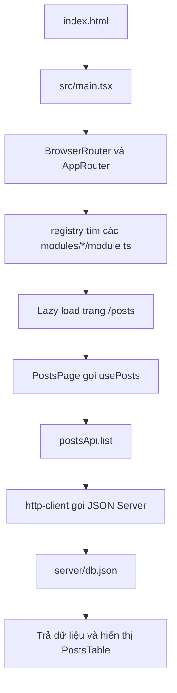

# Greenwich Social

Ứng dụng quản lý bài viết bằng React và TypeScript. Người dùng có thể xem danh sách, tìm kiếm theo tiêu đề/nội dung, thêm, sửa, xóa và chọn trạng thái xuất bản. API giả lập bằng JSON Server, dữ liệu được lưu trong `server/db.json`.

## 1. Công nghệ và vai trò

| Công nghệ                             | Vai trò trong dự án                                     |
| ------------------------------------- | ------------------------------------------------------- |
| React 19 + React DOM                  | Xây dựng giao diện bằng component và quản lý trạng thái |
| TypeScript 5.8                        | Khai báo kiểu dữ liệu, kiểm tra kiểu khi build          |
| Vite 6                                | Chạy máy chủ phát triển và đóng gói frontend            |
| React Router DOM 7                    | Điều hướng đến `/posts`, tải trang bằng lazy loading    |
| Tailwind CSS 4 + tw-animate-css       | Viết style và hiệu ứng                                  |
| Base UI, class-variance-authority, cn | Thành phần UI và các biến thể style                     |
| React Hook Form + Yup + resolvers     | Quản lý form, kiểm tra và chuẩn hóa dữ liệu nhập        |
| Lucide React + Sonner                 | Icon và thông báo thành công/thất bại                   |
| JSON Server 0.17.4                    | Cung cấp REST API CRUD từ file JSON                     |
| concurrently                          | Chạy frontend và API cùng một lệnh                      |
| Vitest + Testing Library + jsdom      | Kiểm thử schema và tương tác giao diện                  |
| ESLint + Prettier                     | Kiểm tra quy tắc code và định dạng                      |

Các phiên bản trên lấy theo khai báo trong `package.json`; `package-lock.json` khóa phiên bản cài đặt cụ thể.

## 2. Cài đặt và chạy

Cần có Node.js và npm. Có thể dùng Node.js 22.x để phù hợp với các công cụ hiện có trong dự án.

Mở terminal PowerShell tại thư mục dự án:

```powershell
cd D:\lab\greenwich-social-final
npm ci
```

Tạo cấu hình môi trường nếu chưa có `.env`:

```powershell
Copy-Item .env.example .env
```

Nội dung mặc định:

```dotenv
VITE_API_URL=http://127.0.0.1:3001
```

Nếu không có biến này, frontend cũng dùng địa chỉ mặc định trên. Khi đổi `.env`, khởi động lại Vite. Biến có tiền tố `VITE_` được đưa vào frontend, vì vậy không đặt thông tin bí mật ở đây.

### Chạy nhanh bằng npm start

```powershell
npm start
```

Lệnh này dùng `concurrently` chạy cả hai tiến trình:

- Frontend: `npm run dev`, thường tại <http://127.0.0.1:5173/posts>.
- API: `npm run api`, tại <http://127.0.0.1:3001/posts>.

Mở địa chỉ frontend được Vite in trong terminal. Nếu cổng 5173 bận, Vite có thể chọn cổng khác. Truy cập `/` sẽ tự chuyển sang `/posts`. Nhấn `Ctrl+C` tại terminal để dừng.

### Chạy riêng từng phần

Terminal 1:

```powershell
npm run api
```

Terminal 2:

```powershell
npm run dev
```

Chỉ chạy frontend thì các chức năng dữ liệu vẫn cần API đang hoạt động.

### Các lệnh khác

| Lệnh              | Ý nghĩa                                            |
| ----------------- | -------------------------------------------------- |
| `npm run build`   | Kiểm tra TypeScript rồi build frontend vào `dist/` |
| `npm run preview` | Xem bản frontend đã build; cần chạy API riêng      |
| `npm test`        | Chạy toàn bộ test một lần                          |
| `npm run lint`    | Kiểm tra code bằng ESLint                          |
| `npm run format`  | Định dạng và ghi lại file bằng Prettier            |

`build` chỉ tạo frontend, không đóng gói JSON Server thành backend triển khai thực tế.

## 3. Cấu trúc thư mục và vai trò

```text
.
├── server/
│   └── db.json                    # Dữ liệu bài viết, JSON Server đọc/ghi tại đây
├── src/
│   ├── main.tsx                   # Điểm khởi động: React, router, toast, CSS
│   ├── index.css                  # Style chung, Tailwind và theme
│   ├── router/
│   │   ├── registry.ts            # Tự tìm module, kiểm tra route và chọn trang mặc định
│   │   └── index.tsx              # Tạo Routes, lazy loading, chuyển hướng
│   ├── core/                      # Phần dùng chung giữa các module
│   │   ├── components/
│   │   │   ├── ui/                # Button, Input, Table, Dialog, Kbd, Sonner
│   │   │   ├── form-modal.tsx     # Khung hộp thoại form
│   │   │   ├── action-modal.tsx   # Hộp thoại xác nhận thao tác
│   │   │   ├── page-loading.tsx   # Trạng thái chờ tải trang
│   │   │   └── shortcut-kbd.tsx   # Nhãn phím tắt trên giao diện
│   │   ├── config/shortcuts.ts    # Cấu hình phím tắt tập trung
│   │   ├── lib/use-shortcut.ts    # Xử lý sự kiện bàn phím
│   │   └── types/module.ts        # Kiểu AppModule và ModuleRoute
│   ├── modules/
│   │   └── social/
│   │       ├── module.ts          # Khai báo module social và route /posts
│   │       ├── api/
│   │       │   ├── config.ts      # Đọc địa chỉ API từ môi trường
│   │       │   ├── http-client.ts # fetch, header JSON, timeout và xử lý lỗi
│   │       │   └── posts-api.ts   # Các hàm list/create/update/remove
│   │       ├── components/
│   │       │   ├── posts-toolbar.tsx # Tìm kiếm và nút thêm
│   │       │   ├── posts-table.tsx   # Danh sách và nút sửa/xóa
│   │       │   └── post-form.tsx     # Form thêm/sửa và hiển thị lỗi
│   │       ├── hooks/use-posts.ts # Tải dữ liệu, trạng thái chờ/lỗi, cập nhật danh sách
│   │       ├── pages/
│   │       │   ├── posts-page.tsx # Ghép giao diện, điều phối CRUD và tìm kiếm
│   │       │   └── posts-page.test.tsx
│   │       ├── schema/
│   │       │   ├── post-schema.ts # Quy tắc kiểm tra dữ liệu bằng Yup
│   │       │   └── post-schema.test.ts
│   │       └── types/post.ts      # Kiểu Post và PostInput
│   └── test/setup.ts              # Thiết lập môi trường test
├── .env.example                   # Mẫu cấu hình địa chỉ API
├── index.html                     # Trang HTML chứa phần tử root
├── package.json                   # Thư viện và các lệnh chạy
├── package-lock.json              # Khóa phiên bản thư viện
├── vite.config.ts                 # Plugin React/Tailwind, alias @, cấu hình test
├── tsconfig.json                  # Cấu hình TypeScript
├── eslint.config.js               # Cấu hình lint
└── .prettierrc.json               # Cấu hình định dạng
```

Alias `@` trỏ tới `src`, ví dụ `@/core/components/ui/button`. `core` chứa phần tái sử dụng; `modules/social` chứa nghiệp vụ bài viết; `router` kết nối các module với ứng dụng.

## 4. Luồng hoạt động

### Khởi động và tải danh sách



`registry.ts` bỏ qua module có `enabled: false`, sắp xếp theo `order` rồi `id`, và phát hiện ID hoặc đường dẫn trùng. Router chuyển `/` và đường dẫn không khớp về trang mặc định. Trong lúc tải code trang, giao diện hiển thị `PageLoading`.

`usePosts` tải danh sách khi trang được mount. API trả bài viết theo ID giảm dần. Khi lỗi tải, trang hiển thị thông báo cùng nút **Thử lại**.

### Thêm và sửa bài viết

1. Người dùng chọn **Thêm bài viết** hoặc **Sửa**. `PostsPage` lưu trạng thái mở form và bài đang sửa.
2. `PostForm` khởi tạo dữ liệu bằng React Hook Form; bài mới mặc định `published: false`.
3. Khi lưu, Yup kiểm tra dữ liệu. Nếu sai, form hiển thị lỗi tại trường tương ứng và không gửi API.
4. Dữ liệu hợp lệ được chuyển cho `postsApi.create` (POST) hoặc `postsApi.update` (PATCH), thông qua `usePosts.mutate`.
5. JSON Server ghi dữ liệu vào `server/db.json` và trả kết quả.
6. Thành công: hook thêm/cập nhật bài trong state, trang đóng form và hiện toast. Nếu lỗi: giữ form và nội dung để thử lại.

Trong khi gửi thay đổi, `busy` và khóa trong hook giúp chặn thao tác gửi lặp. Danh sách chỉ được cập nhật sau khi API trả thành công.

### Xóa và tìm kiếm

- **Xóa:** chọn bài → mở hộp thoại xác nhận → xác nhận mới gửi DELETE → thành công thì loại bài khỏi state. Chọn hủy sẽ không gửi yêu cầu xóa.
- **Tìm kiếm:** lọc ngay trên danh sách đã tải theo cả tiêu đề và nội dung. Chuỗi được chuyển chữ thường, bỏ dấu tiếng Việt và khoảng trắng đầu/cuối; không gọi API tìm kiếm riêng.
- **Xuất bản:** là trường boolean được lưu cùng bài viết. Hiện ứng dụng chưa có quy trình duyệt hay trang công khai riêng cho bài đã xuất bản.

## 5. Dữ liệu và API

```ts
type PostInput = {
  title: string
  content: string
  published: boolean
}
type Post = PostInput & { id: number }
```

| Trường      | Quy tắc trong form                              |
| ----------- | ----------------------------------------------- |
| `title`     | Bắt buộc, trim, tối đa 120 ký tự                |
| `content`   | Bắt buộc, trim, tối đa 2.000 ký tự              |
| `published` | Bắt buộc có giá trị boolean; `false` vẫn hợp lệ |
| `id`        | ID bài viết do API cung cấp khi tạo             |

| HTTP   | Đường dẫn                     | Chức năng                      |
| ------ | ----------------------------- | ------------------------------ |
| GET    | `/posts?_sort=id&_order=desc` | Lấy danh sách theo ID giảm dần |
| POST   | `/posts`                      | Tạo bài viết                   |
| PATCH  | `/posts/:id`                  | Cập nhật bài viết              |
| DELETE | `/posts/:id`                  | Xóa bài viết                   |

`http-client.ts` đặt header JSON và hủy yêu cầu sau 10 giây. Nó chuyển lỗi HTTP, lỗi kết nối và timeout thành thông báo để giao diện xử lý.

JSON Server là API giả lập, chưa có đăng nhập, phân quyền hay kiểm tra schema phía server. Quy tắc Yup hiện nằm ở frontend. Các thao tác thêm/sửa/xóa làm thay đổi trực tiếp file `server/db.json` và dữ liệu được giữ sau khi khởi động lại API.

## 6. Phím tắt đang dùng trên trang bài viết

| Phím | Chức năng                                      |
| ---- | ---------------------------------------------- |
| F4   | Mở form thêm bài khi trang đã tải và không bận |
| F2   | Lưu form thêm/sửa đang mở                      |
| Esc  | Hủy/đóng form khi không đang lưu               |

Cấu hình ở `src/core/config/shortcuts.ts`; nhãn nút và bộ xử lý cùng đọc từ đó. File có thêm một số phím dùng chung, nhưng không phải tất cả đã được gắn vào trang bài viết.

## 7. Kiểm thử và mở rộng

Test hiện có kiểm tra trim dữ liệu, trường bắt buộc, giới hạn độ dài và trạng thái xuất bản; test giao diện kiểm tra thêm, sửa trạng thái, hủy xóa và xác nhận xóa. Test giao diện giả lập `fetch`, không cần chạy JSON Server và không thay đổi dữ liệu thật.

Muốn thêm module nghiệp vụ, tạo `src/modules/<ten-module>/module.ts` với default export đúng kiểu `AppModule`, khai báo ID duy nhất, thứ tự và các route có hàm `load`. Registry tự phát hiện module theo mẫu `modules/*/module.ts`, không cần import module thủ công vào router. Route cần bắt đầu bằng `/`, không dùng `/` hay `*`, và không trùng route khác.

## 8. Lỗi thường gặp

| Hiện tượng                        | Cách xử lý                                                                                        |
| --------------------------------- | ------------------------------------------------------------------------------------------------- |
| Không kết nối được API            | Chạy `npm run api`, kiểm tra `http://127.0.0.1:3001/posts` và `VITE_API_URL`                      |
| Cổng 3001 đang được dùng          | Dừng tiến trình đang chiếm cổng hoặc sửa cổng trong script `api` và địa chỉ trong `.env` cho khớp |
| Không thấy giao diện ở cổng 5173  | Xem URL thực tế Vite in ra trong terminal                                                         |
| Đổi `.env` nhưng chưa có tác dụng | Dừng và chạy lại frontend; nếu dùng bản build thì build lại                                       |
| Không cài được bằng `npm ci`      | Kiểm tra phiên bản Node/npm, kết nối mạng và tính đồng bộ của `package.json` với lockfile         |
